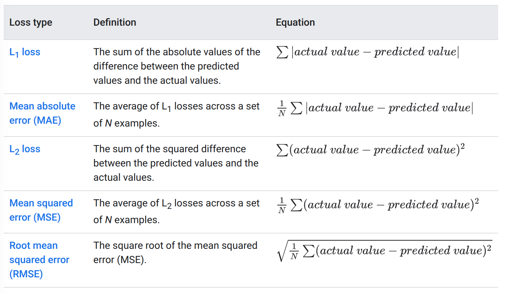
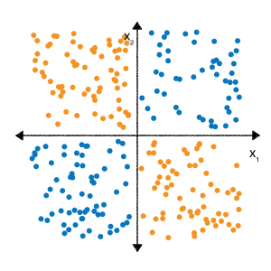
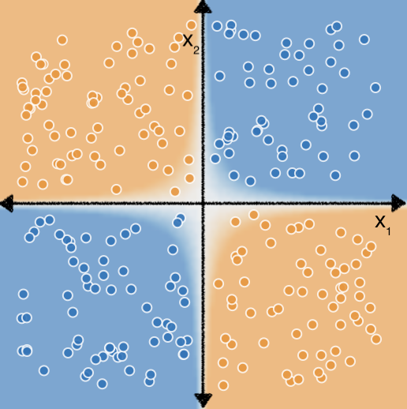
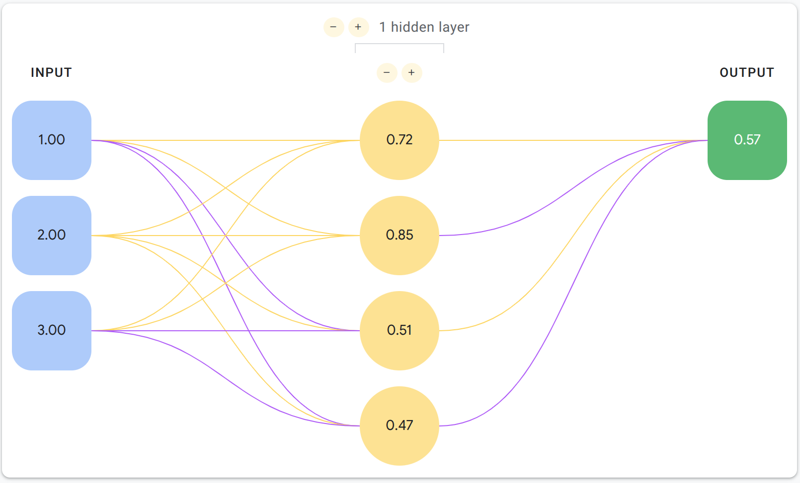
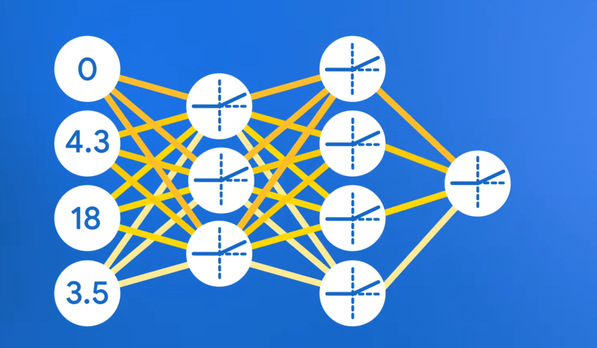

Hướng thực hiện đã chọn: CNN làm mô hình baseline và BEATs làm hướng Self-Supervised Learning (SSL) chính

Đã tìm hiểu được về:

1. Self-supervised learning
2. Mel Spectrogram

======================================================================================================

Thư viện Pytorch?
Mạng CNN?

\*\*\*Pytorch: https://pytorch.org/get-started/locally/

1. Tensor? [Sample Code](../learning/tensor.py)

- Tensor là lớp cấu trúc đa chiều, được PyTorch thiết kế để hỗ trợ tính toán Deep Learning và tự động tính đạo hàm.
- VD các cấu trúc có số chiều khác nhau:
  - Số đơn: 5 - 0 chiều
  - Mảng hay vector: [1,2,3] - 1 chiều
  - Ma trận: [1,2,3] - 2 chiều
    [4,5,6]
  - Tensor: Nó gồm 3 chiều trở lên
- Các thuộc tính quan trọng:
  - shape: kích thước của từng chiều
  - ndim: số chiều của Tensor
  - dtype: kiểu dữ liệu (như float32 hoặc int64)
  - device: Tensor đang nằm trên CPU hay GPU
- Áp dụng trong bài toán phân loại âm thanh:
  - Có thể dùng tensor để biểu diễn 1 đoạn âm thanh có n mẫu
  - Với mel-spectrogram, dữ liệu có thể là [batch, freq, time] (Có thể thấy trong biểu đồ spectrogram)
  - Hình dạng thực tế đưa vào phụ thuộc vào cách tiền xử lý âm thanh
  - Cần biết trước dữ liệu đưa vào như thế nào để sử dụng Pytorch

2. Autograd - tính đạo hàm tự động [Sample Code](../learning/autograd.py)

3. Xây dựng mô hình Neutral Network? [Sample Code](../learning/NN.py)

- Để xây dựng mô hình thì Pytorch cung cấp torch.nn
- Có thể ứng dụng đến các lớp thương gặp trong CNN

4. Optimizer và quá trình huấn luyện [Sample Code](../learning/optimize.py)

- Loss function: đo mức độ sai của dự đoán
- Optimizer: Cập nhật trọng số của mô hình dựa trên gradient

5. DataLoader: Đưa dữ liệu vào mô hình [Sample Code](../learning/dataloader.py)

- Dataset: Định nghĩa cách lấy một mẫu dữ liệu và nhãn
- DataLoader: Chia batch, xáo trộn dữ liệu, nạp mẫu
- Training Loop: Dự đoán -> Loss -> Gradient -> Cập nhật

======================================================================================================

\*\*\* Machine Learning [Google - ML](https://developers.google.com/machine-learning/intro-to-ml)

- Về cơ bản, ML là quá trình huấn luyện một phần mềm, được gọi là model, để có thể tạo ra dự đoán hoặc tạo ra nội dung từ dữ liệu
- Ví dụ đơn giản: Giả sử ta muốn tạo ra một app dùng để dự đoán thời tiết có mưa
  - Chúng ta sẽ có 2 cách tiếp cận: Traditional approach hoặc ML approach
  - Tiếp cận theo cách truyền thống, ta sẽ phải tạo ra một mô hình vật lý về khí quyển và bề mặt Trái Đất, tính toán lượng lớn phương trình về động lực học chất lưu. Đây là một bài toán cực khó
  - Nếu sử dụng cách tiếp cận ML, ta sẽ đưa cho mô hình một lượng dữ liệu khổng lồ về thời tiết, cho đến khi mô hình có thể học được mối liên hệ toán học giữa những hiện tượng thời tiết có thể tạo ra lượng mưa khác nhau. Sau khi được huấn luyện, ta sẽ cho mô hình những dữ liệu về thời tiết hiện tại, và từ đó có thể dự đoán được lượng mưa
- Các loại ML được phân loại vào 1 hay nhiều nhóm sau đây dựa trên cách nó dự đoán hoặc tạo ra nội dung
  - Supervised Learning (Học có giám sát)
  - Unsupervised Learning (Học không giám sát)
  - Reinforcement Learning (Học tăng cường)
  - Generative AI (AI tạo sinh)

======================================================================================================

\*\*\* Supervised Learing? Unsupervised Learning? Reinforcement Learning? Generative AI?

1. Supervised Learning:

- Mô hình học có giám sát là mô hình có thể đưa ra dự đoán sau khi được đưa cho lượng lớn dữ liệu với đáp án đúng và sau đó có thể đưa ra được mối quan hệ giữa các phần trong dữ liệu có thể dẫn đến đáp án đúng
- Giống như việc học sinh học những đề bài thi cũ cùng với đáp án rồi sau đó có thể làm tốt bài thi kì này vậy
- Học có giám sát là việc con người đã cung cấp dữ liệu cho hệ thống học máy với các đáp án chính xác đã biết.
- Có hai trường hợp phổ biến nhất dùng SL là regression(hồi quy) and classification(phân loại).

2. Regression

- Quay lại với bài toán dự đoán mưa
- Mô hình hồi quy là mô hình đưa ra dự đoán dưới dạng con số. Tức là sẽ đưa ra con số dự đoán về lượng mưa, có thể là mm, cm. VD: 100, 200 ...

3. Classfication

- Mô hình phân loại là mô hình có thể đưa ra dự đoán về khả năng xảy ra với cách phân loại nào đó
- Có 2 dạng của classfication:
  - Binary classification (Phân loại nhị phân)
  - Multiclass classification (Phân loại đa lớp)
- Mô hình phân loại nhị phân là mô hình đưa ra dự đoán chỉ có 2 giá trị là "có" hoặc "không". Tức là đối với VD trên sẽ là "có mưa" hoặc "không có mưa"
- Mô hình phân loại đa lớp là mô hình đưa ra dự đoán có nhiều hơn 2 giá trị. Trong VD trên, mô hình có thể đưa ra dự đoán là mưa, có sương mù, nắng, có tuyết ...

4. Unsupervised Learning:

- Một mô hình học không giám sát là mô hình dùng để xác định những quy luật có nghĩa trong một tập dữ liệu
- Nhiều mô hình học không giám sát dựa vào một kỹ thuật tên là clustering(phân cụm) để phân loại những dữ liệu giống nhau vào 1 nhóm (clusters)
- Clustering khác với Multiclass classification là các nhóm không được con người đặt ra.
- Ví dụ như một mô hình học không giám sát sẽ phân loại thành các cụm trong tập dữ liệu thời tiết, dựa vào nhiệt độ, từ đó đưa ra các vùng để có thể xác định các mùa. Con người sẽ phải đặt tên cho những nhóm dựa vào hiểu biết vào tập dữ liệu đó

5. Reinforcement learning

- Mô hình học tăng cường đưa ra dự đoán bằng cách nhận thưởng hoặc bị phạt dựa vào những hành động được thể hiện trong môi trường huấn luyện. Một hệ thống học tăng cường tạo ra một chính sách để tạo ra chiến lược tốt nhất để nhận được nhiều phần thưởng nhất
- Học tăng cường được dùng để huấn luyện robot làm nhiệm vụ, như là đi lại trong phòng và các chương trình phần mềm

6. Generative AI

- AI tạo sinh là loại mô hình có thể tạo ra nội dung từ dữ liệu đầu vào của người dùng
- Ví dụ như tạo ra những bức ảnh, những nhạc phổ, tóm tắt nội dung, chỉnh sửa ảnh ...
- AI tạo sinh có thể nhận nhiều kiểu đầu vào, và tạo ra nhiều kiểu đầu ra. Ví dụ:
  - Text-to-text
  - Text-to-image
  - Text-to-video
  - Text-to-code
  - Text-to-speech
  - Image and text-to-image
- AI tạo sinh họa động dựa vào việc học những quy luật trong dữ liệu với mục tiêu là tạo ra một dữ liệu mới nhưng giống cũ.
- Để có thể tạo ra những nội dung sáng tạo và riêng biệt, AI tạo sinh đầu tiên được huấn luyện dựa trên học không giám sát, để mô hình có thể học bắt chước lại dữ liệu được huấn luyện. Mô hình sau đó có thể được tiếp tục huấn luyện sử dụng học có giám sát hoặc học tăng cường trên dữ liệu liên quan đến nhiệm vụ mà mô hình phải thực hiện, như là tóm tắt một bài viết hoặc chỉnh sửa 1 hình ảnh

======================================================================================================
Supervised Learning?

1. Các khái niệm cơ bản

- Tự học có giám sát được dựa trên những khái niệm sau:
  - Data (Dữ liệu)
  - Model (Mô hình)
  - Training (Huấn luyện)
  - Evaluating (Đánh giá)
  - Inferene (Suy luận)

2. Data

- Data chính là nguồn lực của ML
- Data có thể là từ, số được lưu trong bảng, hoặc giá trị của các điểm ảnh và dạng sóng của hình ảnh và file âm thanh
- Chúng ta lưu những dữ liệu liên quan với nhau thành 1 tập dữ liệu (dataset). VD:
  - Những bức ảnh mèo
  - Giá cả nhà cửa
  - Thông tin về thời tiết
- Tập dữ liệu (Datasets) được tạo thành từ những ví dụ bao gồm các đặc trưng (features) và nhãn (label).
- Features là những giá trị mà một mô hình học có giám sát sử dụng để có thể dự đoán ra label
- Nhãn chính là đáp án, là giá trị mà con người muốn mô hình dự đoán
- Trong VD về mô hình dự đoán mưa, features có thể là kinh độ, vĩ độ, nhiệt độ, độ ẩm... và label có thể là lượng mưa
- Những ví dụ có chứa cả features và label được gọi là những ví dụ đã được gán nhãn (labeled examples)
- Ngược lại, những ví dụ không được gán nhãn (unlabeled examples) là những ví dụ gồm features nhưng không có label

3. Đặc điểm của tập dữ liệu

- Một tập dữ liệu đặc trưng bởi kích thước (size) và tính đa dạng (diversity)
- Kích thước nói lên số lượng các ví dụ
- Tính đa dạng nói lên phạm vi của các ví dụ đó
- Một tập dữ liệu tốt là tập dữ liệu vừa lớn vừa có tính đa dạng cao
- Kích thước và tính đa dạng của tập dữ liệu độc lập với nhau. Tức là một tập dữ liệu lớn thì chưa chắc nó đã đa dạng, và một tập dữ liệu đa dạng chưa chắc nó đã có kích thước lớn
- VD, tập dữ liệu có thể bao gồm dữ liệu của 1 thế kỉ nhưng chỉ có ở tháng 7. Dùng tập dữ liệu này để dự đoán lượng mưa ở tháng 1 thì không đáng tin cậy
- Ngược lại, nếu như tập dữ liệu bao gồm chỉ một vài năm nhưng lại có tất cả các tháng trong năm thì dự đoán vẫn không đáng tin cậy bởi vì nó không có đủ dữ liệu các năm để có thể học được sự biến động trong lượng mưa
- Một tập dữ liệu có thể được đặc trung bởi số lượng các đặc trưng (numbers of its features).
- VD: Tập dữ liệu thời tiết có thể bao gồm hàng trăm những đặc trưng từ những bức ảnh từ vệ tinh đến sự bao phủ của mây. Một tập dữ liệu khác cũng có thể chỉ bao gồm 3 đến 4 đặc trưng như nhiệt độ, độ ẩm, áp suất khí quyển ...
- Tập dữ liệu gồm nhiều đặc trưng hơn có thể giúp mô hình phát hiện ra những tác động khác và đưa ra những dự đoán tốt hơn
- Tuy nhiên, tập dữ liệu với nhiều đặc trưng hơn không luôn giúp mô hình dự đoán tốt hơn bởi một vài đặc trưng có thể không có mối liên hệ gì đến nhãn

4. Model

- Trong tự học có giám sát, mô hình chính là tập hợp phức tạp các con số xác định mối quan hệ toán học từ
  các mẫu đặc trưng đầu vào cụ thể đến nhãn đầu ra cụ thể. Mô hình phát hiện ra những mối quan hệ này qua huấn luyện

5. Training

- Trước khi một mô hình học có giám sát có thể đưa ra dự đoán, nó phải được huấn luyện (Training)
- Để huấn luyện mô hình, ta đưa cho nó một tập dữ liệu gồm những ví dụ được gán nhãn
- Mục tiêu của mô hình là tìm ra phương án tốt nhất để dự đoán nhãn từ những đặc trưng
- Mô hình tìm ra phương án tốt nhất bằng cách so sánh giá trị nó dự đoán với giá trị thực sự của nhãn
- Dựa vào sự khác biệt giữa giá trị dự đoán và giá trị thực sự - định nghĩa là sự mất mát (loss) - mô hình dần dần cập nhật phương án của nó
- Nói cách khác, mô hình học được mối quan hệ toán học giữa đặc trưng và nhãn để nó có thể tạo ra dự đoán trên những dữ liệu chưa xuất hiện
- Điều này cũng giải thích rằng tại sao tập dữ liệu lớn và đa dạng lại tạo ra một mô hình tốt hơn. Mô hình sẽ có được nhiều dữ liệu hơn với giá trị trong phạm vi lớn hơn và có thể hiểu được tôt hơn mối quan hệ giữa đặc trưng và nhãn
- Trong quá trình huấn luyện, người huấn luyện có thể điều chỉnh đến cấu hình và đặc trưng mô hình dùng để dự đoán. VD như một số đặc trưng có thể dễ dùng để dự đoán hơn so với những đặc trưng khác
- Vì vậy, người huấn luyện có thể lựa chọn những đặc trưng nào dùng cho mô hình trong quá trình huấn luyện
- VD, giả sử tập dữ liệu thời tiết bao gồm đặc trưng về time_of_day (thời điểm trong ngày). Trong trường hợp này, người huấn luyện có thể chọn thêm hoặc xóa đặc trưng này trong quá trình huấn luyện để xem thử mô hình đưa ra dự đoán tốt hơn khi có hay không có đặc trung này

6. Evaluating

- Ta đánh giá một mô hình đã được huấn luyện (trained model) để xác định mức độ học của nó.
- Khi đánh giá một mô hình, ta dùng những ví dụ đã được gán nhãn, nhưng chỉ đưa cho mô hình những đặc trưng của tập dữ liệu. Sau đó ta so sánh dự đoán của mô hình so với giá trị đúng của nhãn
- Dựa vào những dự đoán của mô hình, ta có thể sẽ cần tiếp tục huấn luyện trước khi triển khai mô hình ra ứng dụng thực tế

7. Inference

- Khi mà ta đã hài lòng với kết quả khi đánh giá mô hình, ta có thể sử dụng mô hình đó để đưa ra dự đoán, gọi là suy luận (inferences), trên những ví dụ không được gán nhãn
- Trong VD về ứng dụng thời tiếp, ta sẽ đưa cho mô hình những điều kiện thời tiết hiện tại, như nhiệt độ, độ ẩm... và nó sẽ đưa ra dự đoán về lượng mưa

======================================================================================================

\*\*\* Mạng neutral network, loss function, gradient?
[Google - Neutral network](https://developers.google.com/machine-learning/crash-course/neural-networks)
[Google - Loss Function](https://developers.google.com/machine-learning/crash-course/linear-regression/loss)

======================================================================================================

1. Loss

- Mất mát (Loss) là đại lượng đo sự sai lệch của dự đoán của mô hình
- Mất mát đo khoảng cách giữa dự đoán của mô hình và nhãn thực sự.
- Mục đích của việc huấn luyện mô hình là để giảm thiểu mất mát, giảm nó về mức thấp nhất có thể

2. Distance of Loss

- Trong thống kê và trong ML, loss đo sự sai khác giữa giá trị được dự đoán và giá trị thực tế.
- VD: Model dự đoán giá trị là 3 trong khi giá trị nhãn là 5. Ta không quan tâm giá trị loss âm là 3 - 5 = -2 mà ta quan tâm đến khoảng cách là 2.
- Ta có thể dùng các cách sau để loại bỏ dấu:
  - Lấy giá trị tuyệt đối sự sai khác
  - Bình phương sự sai khác

3. Types of loss
   

4. Gradient

- Gradient là đạo hàm riêng của hàm mất mát (loss function) đối với các trọng số trong mô hình.
- Việc tìm gradient là để tìm ra hướng tăng lớn nhất của loss khi các trọng số thay đổi
- Mục tiêu của huấn luyện mô hình là tối thiểu loss, vì vậy ta phải lấy hướng ngược lại của gradient để có thể tìm ra hướng giảm của loss function. Từ đó điều chỉnh các trọng số và bias để giảm loss. Đây gọi là gradient descent

======================================================================================================

1. Neutral network (Mạng nơ-ron nhân tạo)

- Trong các bài toán phân loại, ta sẽ thường gặp hơn bài toán phân loại phi tuyến. Tức là mô hình sẽ không thể dự đoán chính xác nhãn dưới dạng b + w1x1 + w2x2. Nói cách khác mặt phẳng dự đoán (decision surface) không phải là đường thẳng
- 
- Trong ví dụ trên, một mô hình tuyến tính không thể đưa ra dự đoán chính xác bằng cách đưa ra dạng tuyến tính b + w1x1 + w2x2.
- Nhưng nếu ta thêm phần biểu diễn phi tuyến giữa x1 và x2 là x3 với x3 = x1 x x2 thì mô hình tuyến tính vẫn có thể học được mối quan hệ phi tuyến giữa x1 và x2: b + w1x1 + w2x2 + w3x3. Ở đây x3 được gọi là đặc trưng chéo (feature cross)
  
- Tuy nhiên, với những tập dữ liệu phức tạp hơn, việc đưa ra những đặc trưng chéo đúng để khớp với mô hình tuyến tính lại cần nhiều thử nghiệm và khó khăn hơn
- Mạng nơ ron nhân tạo (Neutral network) chính là họ các kiến trúc mô hình được tạo ra để tìm ra những mối quan hệ phi tuyến trong dữ liệu.
- Trong quá trình huấn luyện mạng noron nhân tạo, mô hình tự động học những đặc trưng chéo tối ưu để biểu diễn dữ liệu và giảm thiểu mất mát

2. Hidden layer (lớp ẩn)

- Trong mô hình tuyến tính thông thường, ta sẽ nhân các nút đầu vào (input nodes) với trọng số (weights), cộng tất cả lại rồi cộng với độ lệch (bias), từ đó đưa ra kết quả đầu ra
- Ví dụ 1 mô hình tuyến tính dưới dạng: y = b + w1x1 + w2x2 + w3x3
- Nếu ta thêm 1 lớp khác vào mô hình để có thể tạo ra một tổ hợp đầu vào mới, lớp này gọi là lớp ẩn (hidden layer), mỗi nút trong lớp ẩn được gọi là noron (neurons) nó sẽ tăng số lượng tham số của mô hình, giúp mô hình học tốt hơn mối liên hệ giữa các đặc trưng
- Kiến trúc này được gọi là mạng noron nhân tạo (Neural Network)
- Tuy vậy, kiến trúc này vẫn chưa thể cho model hiểu được tính phi tuyến, nó vẫn là tuyến tính nhưng mà phức tạp hơn thôi
  

3. Activation Function (Hàm kích hoạt)

- Vì việc tạo ra lớp mới đơn thuần thì mô hình vẫn chưa thể học được tính phi tuyến, nên ta phải đưa vào một hàm toán học có tính phi tuyến vào mô hình để mô hình có thể học. Hàm này được gọi là hàm kích hoạt (Activation Function)
- Hàm kích hoạt sẽ tính đầu ra của một noron trước khi giá trị đó được đưa vào như là đầu vào để tính toán lớp tiếp theo của mạng noron nhân tạo
- Một số hàm toán học thường dùng để dùng hàm kích hoạt là: sigmoid, tanh và ReLU
  

4. Backpropagation (Thuật toán lan truyền ngược)

- Thuật toán lan truyền ngược là thuật toán thông dụng nhất cho mạng Noron nhân tạo.
- Vanishing Gradients
  - Gradient của những lớp mạng cấp thấp (lớp gần với input hơn) có thể sẽ rất nhỏ. Khi đó, trong 1 mạng sâu (deep network) (Mạng gồm nhiều hơn 1 lớp), tính toán những gradients phải thực hiện nhiều phép tính tích của nhiều phần nhỏ
  - Khi mà gradient của những lớp cấp thấp này tiến dần về 0, ta gọi gradient này đã biến mất (vanish). Các lớp với gradient biến mất sẽ học rất chậm, hoặc không thể học
  - Hàm kích hoạt ReLU có thể giúp ngăn chặn điều này
- Exploding Gradient
  - Khi trọng số của mạng rất lớn, thì gradients của những mạng cấp thấp sẽ gồm nhiều phép tính tích của nhiều phần lớn. Trong trường hợp này, ta sẽ gặp trường hợp bùng nổ gradient (exploding gradients): gradients quá lớn để có thể hội tụ
  - Việc chuẩn hóa sẽ giúp ngăn việc bùng nổ gradient nhưng cũng làm chậm quá trình học
- Dead ReLU Units
  - Khi tổng các trọng số cho đơn vị ReLU giảm về dưới 0, đơn vị ReLU có thể sẽ bị kẹt. Nếu đầu ra là 0, nó sẽ không làm được gì cho đầu ra của mạng, và gradient cũng sẽ không thể chạy qua nó trong quá trình lan truyền ngược.
  - Khi gradient bị chặn, đầu vào của ReLU sẽ không thay đổi được đủ để làm cho tổng trọng số quay về dương
  - Giảm mức độ học có thể giữ cho đơn vị ReLU không "chết"
- Dropout Regularization
  - Một dạng điều chỉnh, gọi là điều chỉnh bỏ sót, rất hữu ích cho mạng neural network.
  - Nó sẽ bỏ ngẫu nhiên những đơn vị kích hoạt (unit activations) trong mạn cho một bước gradient.
  - Càng bỏ nhiều, sự điều chỉnh càng lớn
    - 0.0 = Không điều chỉnh
    - 1.0 = Bỏ hết nút. Mô hình không học được gì
    - Giá trị giữa 0.0 và 1.0 = Có ích

======================================================================================================

CNN?

1. CNN

- CNN (Convolutional Neural Network) hay mạng nơron tích chập là một loại Neural Network thiết kế dùng để học các đặc trưng cục bộ trong dữ liệu, đặc biệt hiệu quả với dữ liệu có cấu trúc như hình ảnh. CNN cũng được sử dụng trong xử lý tín hiệu âm thanh, đặc biệt khi biểu diễn âm thanh dưới dạng spectrogram

- Khi xử lý hình ảnh ở kích thước lớn, đối với NN thông thường sẽ cần một lượng lớn đầu vào và lượng lớn trọng số. CNN sinh ra để có thể giảm thiểu số lượng trọng số trong khi vẫn trích xuất được đặc trưng của ảnh

2. Các lớp dùng để tạo nên CNN gồm:

- Input: giữ giá trị thô từng điểm ảnh, VD như ảnh có kích thước là 32x32 với 3 kênh màu RGB sẽ có kích thước 32x32x3
- Convulation Layer: Tính toán đầu ra của các nơ-ron được kết nối với các vùng cục bộ trong đầu vào, mỗi nơ-ron tính tích vô hướng giữa trọng số của chúng và một vùng nhỏ mà chúng được kết nối trong thể tích đầu vào. Điều này có thể tạo ra kích thước 32x32x12 nếu chúng ta quyết định sử dụng 12 bộ lọc.
- RELU Layer: sẽ áp dụng hàm kích hoạt từng phần tử. Điều này giữ nguyên kích thước của khối 32x32x12.
- POOL Layer sẽ thực hiện thao tác lấy mẫu giảm theo các chiều không gian (chiều rộng, chiều cao), tạo ra kích thước 16x16x12.
- FC Layer (Full-Connected Layer) sẽ tính toán điểm số của các lớp, tạo ra một khối dữ liệu có kích thước 1x1x10, trong đó mỗi số trong 10 số tương ứng với một điểm số của lớp, chẳng hạn như trong 10 hạng mục của CIFAR-10. Giống như các mạng nơ-ron thông thường và như tên gọi của nó, mỗi nơ-ron trong lớp này sẽ được kết nối với tất cả các số trong khối dữ liệu trước đó.
