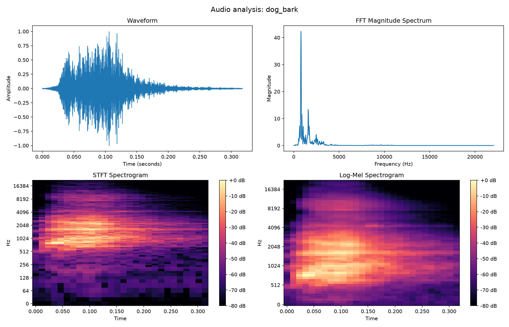
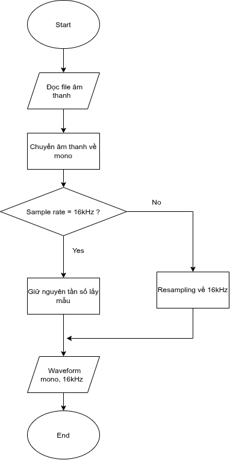
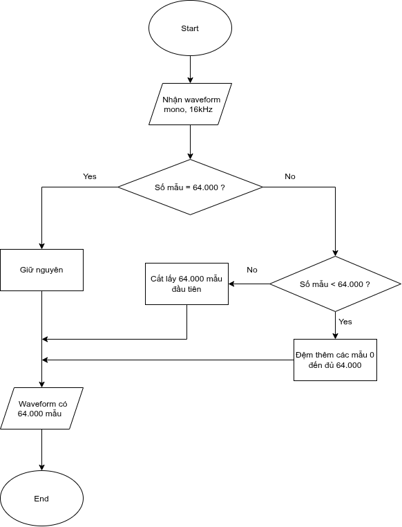
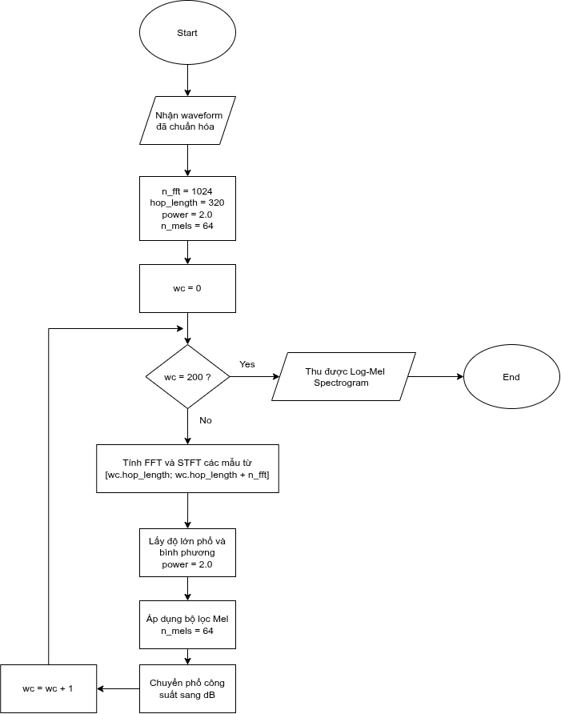
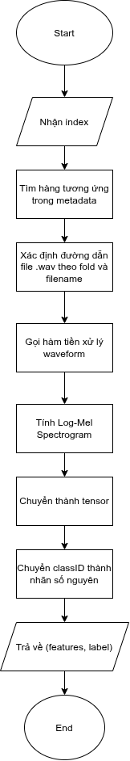

# Week 1 — Data and Pipeline Preparation

## 1. Dataset

- Dataset: UrbanSound8K
- WAV files found: 8732
- Metadata: archive/UrbanSound8K.csv
- Number of classes: 10
- Number of folds: 10

## 2. Exploratory Data Analysis

- Class distribution:
  outputs/figures/class_distribution.png
- Audio visualization:
  outputs/figures/sample_audio_analysis.png

## 3. Preprocessing

- Channels: mono
- Target sample rate: 16000 Hz
- Target duration: 4 seconds
- CNN representation: Log-Mel Spectrogram
- Number of Mel bins: 64

## 4. PyTorch Data Pipeline

- Dataset implementation: src/dataset.py
- DataLoader test: src/test_dataloader.py
- Expected input shape: [batch, 1, 64, 201]

## 5. Issues and Next Steps

- Record any remaining data or pipeline errors.
- Next: build and train the CNN baseline.

======================================================================================================

# Week 1: Preprocessing block

- Trong tuần này, chủ yếu sẽ thiết kế phần khối tiền xử lý dữ liệu.
- Khối tiền xử lý dữ liệu có vai trò biến tín hiệu âm thanh đầu vào thành dữ liệu phù hợp để mô hình học máy có thể tiếp nhận và phân loại.
- Trong khối này, sẽ có những khối nhỏ hơn như sau:
  Kiểm tra và khảo sát dữ liệu -> resampling 16 kHz và cắt đệm về 4s -> Log-Mel spectrogram -> Tensor + nhãn lớp  
  

======================================================================================================

## 1. Kiểm tra và khảo sát dữ liệu

- Với dữ liệu đầu vào là UrbanSound8K, có cấu trúc như sau
  - fold1 - fold10: chứa 8732 file âm thanh .wav, là một bộ dữ liệu âm thanh chuẩn được gán nhãn công khai
  - file UrbanSound8K.csv: Đây là file .csv cung cấp thông tin chi tiết cho từng file âm thanh trên từng dòng, bao gồm:
    - slice_file_name: Tên của tệp âm thanh
    - fsID: ID gốc của đoạn thu âm trên nền tảng [Freesound](https://freesound.org/)
    - start và end: Thời gian bắt đấu và kết thúc của phân đoạn được cắt ra từ đoạn thu âm gốc
    - salience: Độ nổi bật của âm thanh, nhận giá trị 1 (âm thanh tiền cảnh - foreground) hoặc 2 (âm thanh nền - background)
    - fold: Thư mục chứ file âm thanh đó nhận giá trị từ 1 - 10, tương ứng với fold1 - fold10
    - classID: Mã số định danh của loại âm thanh, nhận giá trị từ 0 - 9
    - class: Tên phân loại của lớp âm thanh đó
- Vai trò của khối này là đọc file UrbanSound.csv, từ đó kiểm tra cấu trúc của dữ liệu, bảo đảm dữ liệu có cấu trúc hợp lệ
- Lưu đồ thuật toán: [inspect_dataset.py](../src/inspect_dataset.py)
  Đọc file .csv -> Kiểm tra các cột cần thiết -> Thống kê lớp và fold -> Kiểm tra nhãn trùng lặp hoặc không nhất quán -> Tạo đường dẫn cho từng hàng csv -> Kiểm tra file bị thiếu và file dư -> In báo cáo và vẽ thống kê các lớp  
  
- Ngoài ra trong khối này còn có trực quan hóa âm thanh trước khi đưa vào khối resampling và cắt/đệm sau để có thể so sánh [eda.py](../src/eda.py)
- Lưu đồ thuật toán:
  Đọc mẫu âm thanh -> Tính FFT -> Tính STFT -> Đổi sang thang Mel -> Vẽ Mel Spectrogram  
    
  

## 2. Resampling về 16kHz và cắt/đệm về 4s [preprocess.py](../src/preprocess.py)

- Vì mỗi file âm thanh có thể có tần số lấy mẫu khác nhau cũng như là thời lượng khác nhau nên việc đồng nhất toàn bộ file âm thanh về 1 tần số lấy mẫu và 1 độ dài như nhau sẽ giúp cho mô hình có thể làm việc hiệu quả và tiết kiệm được dữ liệu đầu vào
- Resampling về 16Hz: thống nhất cách lấy mẫu. Hai tệp có thể cùng mô tả một khoảng thời gian nhưng số mẫu có thể khác nhau. Ở đây, chúng ta thống nhất cách lấy mẫu là 16kHz, chuyển tín hiệu sang một tần số lấy mẫu chung
- Cắt/đệm về 4s: thống nhất độ dài. Vì CNN thường được huấn luyện trên các batch dùng nhiều mẫu nên nếu mỗi mẫu có độ dài khác nhau, kích thước tensor đầu vào có thể khác nhau và không thể ghép batch theo cách thông thường. Đối với những mẫu có độ dài ngắn hơn 4s, ta sẽ đệm thêm số 0 vào cuối để đủ 4s, đối với những mẫu có độ dài bằng 4s thì sẽ giữ nguyên, còn đối với những mẫu có độ dài dài hơn 4s thì sẽ cắt bớt
- Sau khi tiến hành resampling và cắt/đệm, mỗi tệp sẽ có số mẫu là 16kHz x 4s = 64.000 (mẫu)
- Lưu đồ thuật toán:  
    
  

## 3. Log-mel spectrogram [preprocess.py](../src/preprocess.py)

- Khối này sẽ nhận waveform đã được chuẩn hóa và chuyển thành ma trận Log-Mel spectrogram
- Lưu đồ thuật toán:  
  
- Giải thích các biến:
  - n_fft: Kích thước cửa sổ FFT/STFT
  - hop_length: khoảng dịch giữa 2 khung liên tiếp
  - n_mels: Số dải tần Mel
  - power = 2: Bình phương phổ trước khi tạo Spectrogram
  - wc: Biến đếm số cửa sổ (vì mỗi cửa sổ có khoảng dịch là 320 nên tổng có 201 cửa sổ)

## 4. Tensor và nhãn lớp: [dataset.py](../src/dataset.py)

- Khối này có vai trò chuyển một bản ghi trong metadata thành dữ liệu mà Pytorch hiểu được
- Lưu đồ thuật toán:  
  

======================================================================================================

## Reference:

1. Salamon, J., Jacoby, C., & Bello, J. P. (2014). A Dataset and Taxonomy for Urban Sound Research. ACM International Conference on Multimedia. Dùng làm tài liệu nguồn về UrbanSound8K.

2. Doshi, K. (2021). Audio Deep Learning Made Simple — Sound Classification, Step-by-Step. Dùng để tham khảo quy trình phân loại âm thanh bằng deep learning.

3. Librosa documentation. librosa.load và librosa.feature.melspectrogram. Dùng để đối chiếu cách đọc audio và tạo phổ Mel.
4. PyTorch documentation. Datasets & DataLoaders. Dùng để đối chiếu cách tổ chức dữ liệu thành batch.
5. Ketan Doshi: Why Mel Spectrograms perform better và Sound Classification, Step-by-Step. Hai bài viết giải thích quy trình tiền xử lý và cách đưa đặc trưng âm thanh vào bộ phân loại
