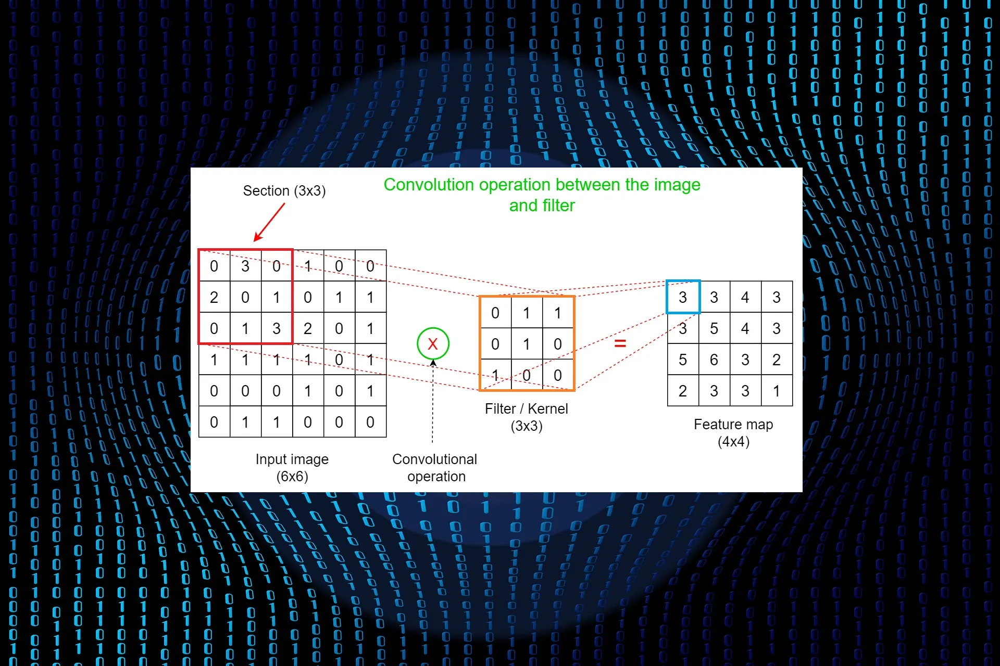

# Reference:

1. Salamon, J., Jacoby, C., & Bello, J. P. (2014). A Dataset and Taxonomy for Urban Sound Research. ACM International Conference on Multimedia.
2. Piczak, K. J. (2015). Environmental Sound Classification with Convolutional Neural Networks. IEEE International Workshop on Machine Learning for Signal Processing.
3. PyTorch. Datasets & DataLoaders.
4. PyTorch. CrossEntropyLoss.
5. PyTorch. Conv2d.
6. PyTorch. Saving and Loading Models.

==================================================================================================

# Mục tiêu: Xây dựng một mô hình CNN baseline- mô hình cơ sở đầu tiên để phân loại 10 lớp âm thanh trong UrbanSound8K

==================================================================================================

## Tổ chức dữ liệu cho quá trình huấn luyện

- Ở phần trước, ta đã xây dựng hai file là data.py và dataset.py
- Để có thể huấn luyện CNN, ta không thể đưa trực tiếp danh sách các file âm thanh vào mô hình, mà cần có một cơ chế nạp dữ liệu:
  - Đọc từng file âm thanh
  - Chuẩn hóa và chuyển âm thanh thành Log-Mel Spectrogram
  - Chuyển đặc trưng thành tensor
  - Gán nhãn tương ứng
  - Gom nhiều mẫu thành từng batch để đưa vào mô hình
- Để xây dựng cơ chế đọc dữ liệu, ta chuyển đổi dữ liệu âm thanh thành Tensor và chia dữ liệu thành 3 tập:
  | Tập dữ liệu | Fold | Số mẫu | Mục đích |
  | --- | --- | --- | --- |
  | Train | 1–8 | 7.079 | Huấn luyện mô hình |
  | Validation| 9 | 816 | Theo dõi và lựa chọn mô hình |
  | Test | 10 | 837 | Đánh giá cuối cùng |
  | Tổng | 1–10 | 8.732 | Toàn bộ dataset |

- Tại sao lại cần phải có 3 tập dữ liệu?
  - Đây là một trong những nguyên tắc quan trọng nhất của ML
  - 3 tập dữ liệu giúp cho mô hình có thể học, đồng thời theo dõi quá trình học và đánh giá kết quả sau huấn luyện, cụ thể:
    - Train: Đây là tập dữ liệu lớn nhất được nạp cho mô hình học từ đó điều chỉnh trọng số
    - Validation: Đây là tập dữ liệu dùng để kiểm tra quá trình học tập của mô hình, kiểm tra xem mô hình có thực sự học tốt hay không, tập dữ liệu này sẽ không được dùng để điều chỉnh trọng số
    - Test: Đây là tập dữ liệu chưa từng được sử dụng trong quá trình huấn luyện, được dùng để đánh giá kết quả cuối cùng sau khi kết thúc quá trình huấn luyện

### 1. src/dataset.py:

- Trong file này, ta xây dựng đối tượng là UrbanSoundMelDataset, có phương thức **getitem** làm những công việc sau:
  - Nhận index
  - Đọc thông tin file từ metadata
  - Tạo đường dẫn đến file âm thanh
  - Load và thực hiện tiền xử lý âm thanh
  - Tạo Log-Mel Spectrogram
  - Chuyển thành tensor
  - Gán nhãn
  - Trả về (features, label)
- Trong phương thức này, có unsqueeze(0) dùng để thêm chiều channel, chuyển Log-Mel từ [64, 201] thành [1, 64, 201]
- Tuy nhiên, thay vì đưa vào mô hình từng mẫu riêng lẻ, ta nhóm 32 mẫu thành 1 batch, rồi mới đưa vào mô hình, nhằm tận dụng khả năng xử lý song song nhiều mẫu của mô hình, tận dụng khả năng tính toán ma trận của GPU/CPU, cũng như là nhằm cân bằng giữa bộ nhớ, tốc độ và đặc tính cập nhật gradient
- Vì vậy, tensor đầu vào của CNN có 4 chiều: batch, channel, frequency và time

### 2. src/cnn.py

- Đây là file xây dựng mô hình AudioCNN, bao gồm:
  - 3 khối tích chập ConvBlock
  - Adaptive Avarage Pooling
  - Flatten
  - Dropout
  - Fully Connect Layer
- Mô hình được xây dựng có tổng cộng 24.058 tham số
- Mô hình CNN này có nhiệm vụ học đặc trưng từ Log-Mel Spectrogram và sử dụng các đặc trưng đó để phân loại âm thanh. Mô hình sẽ học các mẫu đặc trưng từ nhiều ví dụ được gán nhãn. Quá trình này gọi là Feature Learning
- Mô hình CNN được sử dụng là bởi vì:
  - Log-Mel Spectrogram thu được sau khi đi qua khối tiền xử lý tín hiệu là một ma trận hai chiều:
    - Trục dọc là trục tần số (frequency): Biểu diễn các dải tần số Mel
    - Trục ngang là trục thời gian (time): Biểu diễn các thời điểm khác nhau của âm thanh
    - Các phần tử trong ma trận biểu diễn năng lượng của một dải tần số tại một khung thời gian nhất định
  - Mô hình CNN sử dụng một bộ lọc Filter, là một ma trận nhỏ chứa các trọng số số học mà CNN sử dụng để quét qua dữ liệu đầu vào và tìm kiếm các đặc trưng cục bộ
  - Bộ lọc này được mô hình sử dụng quét qua từng vùng nhỏ của Spectrogram, sau đó nó thực hiện phép nhân tích chập và kết quả được ghi vào ma trận đầu ra  
    
  - Vì vậy, việc sử dụng CNN cho dự án sẽ có những lợi ích:
    - Tận dụng cấu trúc không gian của Spectrogram
    - Chia sẻ trọng số giữa các vị trí thông qua Filter
    - Có thể học được những đặc trưng từ đơn giản đến phức tạp qua nhiều lớp
    - Là kiến trúc baseline tương đối gọn, dễ triển khai và đánh giá