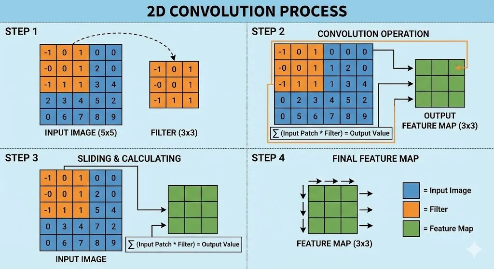
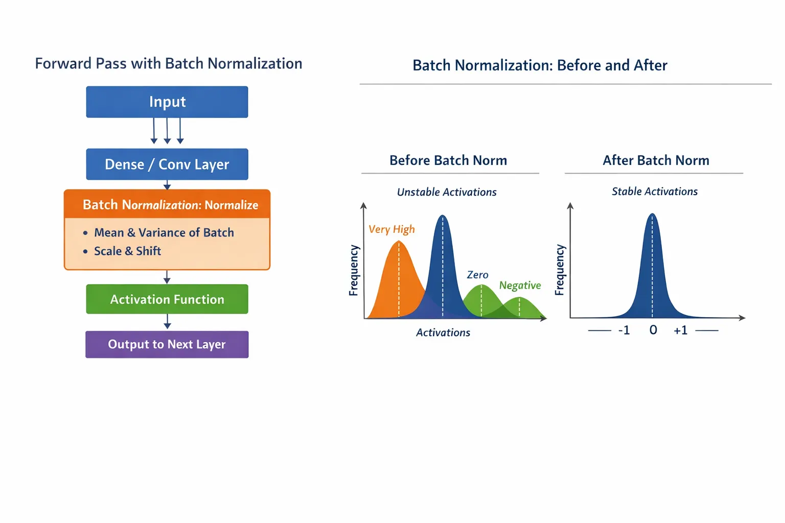
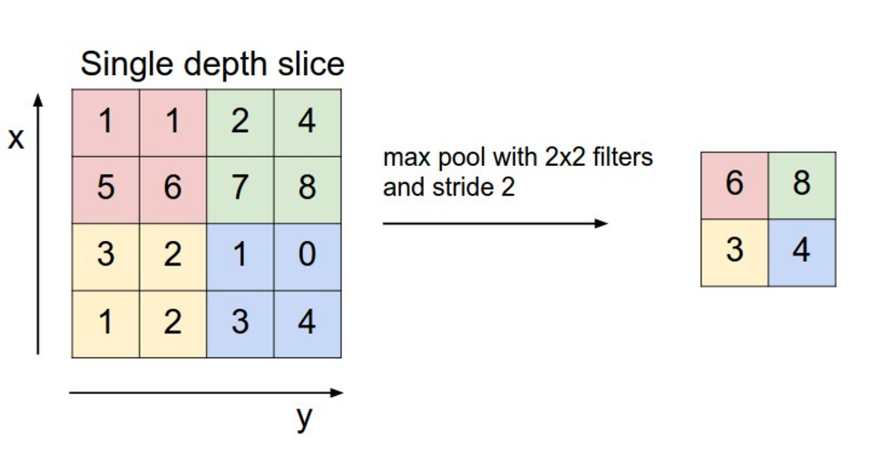
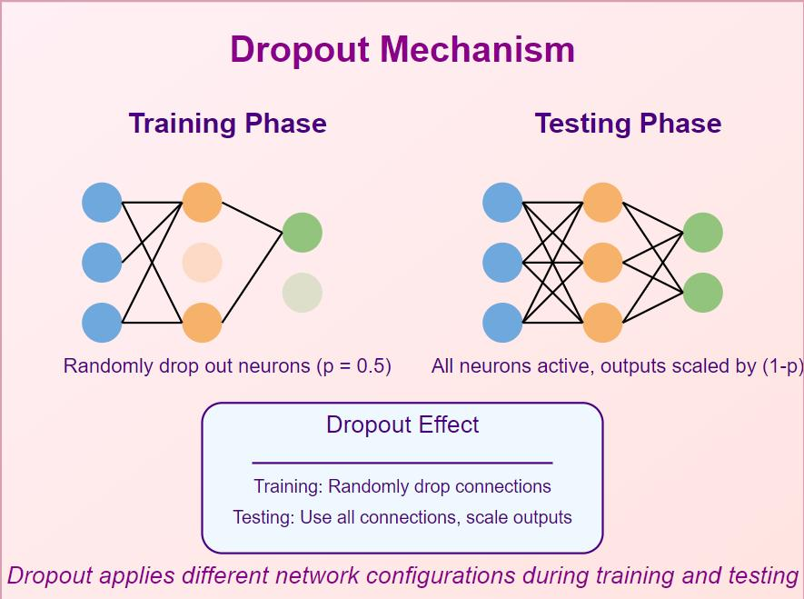
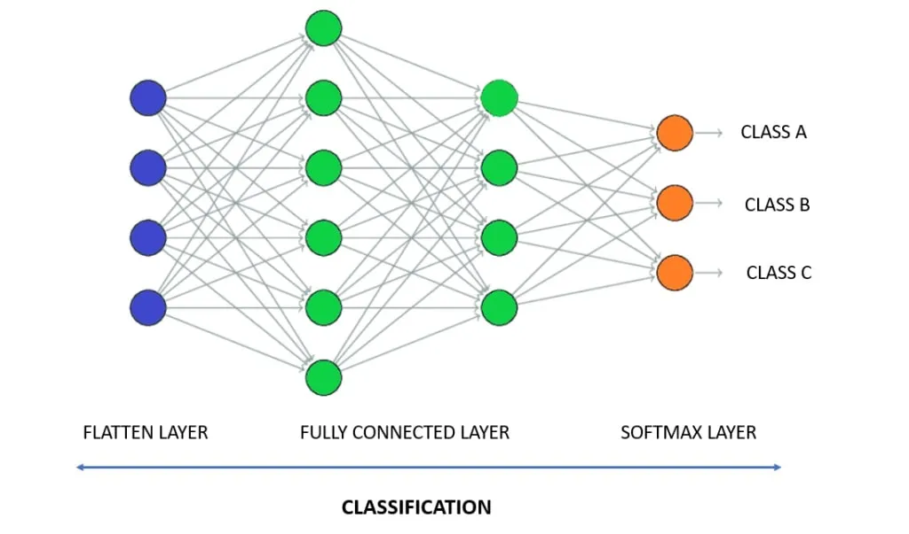

# Reference:

1. Salamon, J., Jacoby, C., & Bello, J. P. (2014). A Dataset and Taxonomy for Urban Sound Research. ACM International Conference on Multimedia.
2. Piczak, K. J. (2015). Environmental Sound Classification with Convolutional Neural Networks. IEEE International Workshop on Machine Learning for Signal Processing.
3. PyTorch. Datasets & DataLoaders.
4. PyTorch. CrossEntropyLoss.
5. PyTorch. Conv2d.
6. PyTorch. Saving and Loading Models.
7. Salamon, J., Jacoby, C., & Bello, J. P. (2014). A Dataset and Taxonomy for Urban Sound Research. Proceedings of the 22nd ACM International Conference on Multimedia, 1041–1044.
8. Piczak, K. J. (2015). Environmental Sound Classification with Convolutional Neural Networks. Proceedings of the IEEE 25th International Workshop on Machine Learning for Signal Processing.
9. Ioffe, S., & Szegedy, C. (2015). Batch Normalization: Accelerating Deep Network Training by Reducing Internal Covariate Shift. Proceedings of the 32nd International Conference on Machine Learning, 37, 448–456.
10. Srivastava, N., Hinton, G., Krizhevsky, A., Sutskever, I., & Salakhutdinov, R. (2014). Dropout: A Simple Way to Prevent Neural Networks from Overfitting. Journal of Machine Learning Research, 15, 1929–1958.
11. Kingma, D. P., & Ba, J. (2015). Adam: A Method for Stochastic Optimization. International Conference on Learning Representations (ICLR).
12. Prechelt, L. (1998). Automatic Early Stopping Using Cross Validation: Quantifying the Criteria. Neural Networks, 11(4), 761–767.

==================================================================================================

# Mục tiêu: Xây dựng một mô hình CNN baseline- mô hình cơ sở đầu tiên để phân loại 10 lớp âm thanh trong UrbanSound8K

==================================================================================================

## Tổ chức dữ liệu cho quá trình huấn luyện

- Ở phần trước, ta đã xây dựng hai file là data.py và dataset.py
- Để có thể huấn luyện CNN, ta không thể đưa trực tiếp danh sách các file âm thanh vào mô hình, mà cần có một cơ chế nạp dữ liệu:
  - Đọc từng file âm thanh
  - Chuẩn hóa và chuyển âm thanh thành Log-Mel Spectrogram
  - Chuyển đặc trưng thành tensor
  - Gán nhãn tương ứng
  - Gom nhiều mẫu thành từng batch để đưa vào mô hình
- Để xây dựng cơ chế đọc dữ liệu, ta chuyển đổi dữ liệu âm thanh thành Tensor và chia dữ liệu thành 3 tập:
  | Tập dữ liệu | Fold | Số mẫu | Mục đích |
  | --- | --- | --- | --- |
  | Train | 1–8 | 7.079 | Huấn luyện mô hình |
  | Validation| 9 | 816 | Theo dõi và lựa chọn mô hình |
  | Test | 10 | 837 | Đánh giá cuối cùng |
  | Tổng | 1–10 | 8.732 | Toàn bộ dataset |

- Tại sao lại cần phải có 3 tập dữ liệu?
  - Đây là một trong những nguyên tắc quan trọng nhất của ML
  - 3 tập dữ liệu giúp cho mô hình có thể học, đồng thời theo dõi quá trình học và đánh giá kết quả sau huấn luyện, cụ thể:
    - Train: Đây là tập dữ liệu lớn nhất được nạp cho mô hình học từ đó điều chỉnh trọng số
    - Validation: Đây là tập dữ liệu dùng để kiểm tra quá trình học tập của mô hình, kiểm tra xem mô hình có thực sự học tốt hay không, tập dữ liệu này sẽ không được dùng để điều chỉnh trọng số
    - Test: Đây là tập dữ liệu chưa từng được sử dụng trong quá trình huấn luyện, được dùng để đánh giá kết quả cuối cùng sau khi kết thúc quá trình huấn luyện

### 1. src/dataset.py:

- Trong file này, ta xây dựng đối tượng là UrbanSoundMelDataset, có phương thức **getitem** làm những công việc sau:
  - Nhận index
  - Đọc thông tin file từ metadata
  - Tạo đường dẫn đến file âm thanh
  - Load và thực hiện tiền xử lý âm thanh
  - Tạo Log-Mel Spectrogram
  - Chuyển thành tensor
  - Gán nhãn
  - Trả về (features, label)
- Trong phương thức này, có unsqueeze(0) dùng để thêm chiều channel, chuyển Log-Mel từ [64, 201] thành [1, 64, 201]
- Tuy nhiên, thay vì đưa vào mô hình từng mẫu riêng lẻ, ta nhóm 32 mẫu thành 1 batch, rồi mới đưa vào mô hình, nhằm tận dụng khả năng xử lý song song nhiều mẫu của mô hình, tận dụng khả năng tính toán ma trận của GPU/CPU, cũng như là nhằm cân bằng giữa bộ nhớ, tốc độ và đặc tính cập nhật gradient
- Vì vậy, tensor đầu vào của CNN có 4 chiều: batch, channel, frequency và time

### 2. src/cnn.py

- Đây là file xây dựng mô hình AudioCNN, bao gồm:
  - 3 khối tích chập ConvBlock
  - Adaptive Avarage Pooling
  - Flatten
  - Dropout
  - Fully Connect Layer
- Mô hình được xây dựng có tổng cộng 24.058 tham số
- Mô hình CNN này có nhiệm vụ học đặc trưng từ Log-Mel Spectrogram và sử dụng các đặc trưng đó để phân loại âm thanh. Mô hình sẽ học các mẫu đặc trưng từ nhiều ví dụ được gán nhãn. Quá trình này gọi là Feature Learning
- Mô hình CNN được sử dụng là bởi vì:
  - Log-Mel Spectrogram thu được sau khi đi qua khối tiền xử lý tín hiệu là một ma trận hai chiều:
    - Trục dọc là trục tần số (frequency): Biểu diễn các dải tần số Mel
    - Trục ngang là trục thời gian (time): Biểu diễn các thời điểm khác nhau của âm thanh
    - Các phần tử trong ma trận biểu diễn năng lượng của một dải tần số tại một khung thời gian nhất định
  - Mô hình CNN sử dụng một bộ lọc Filter, là một ma trận nhỏ chứa các trọng số số học mà CNN sử dụng để quét qua dữ liệu đầu vào và tìm kiếm các đặc trưng cục bộ
  - Bộ lọc này được mô hình sử dụng quét qua từng vùng nhỏ của Spectrogram, sau đó nó thực hiện phép nhân tích chập và kết quả được ghi vào ma trận đầu ra <br>
    
  - Vì vậy, việc sử dụng CNN cho dự án sẽ có những lợi ích:
    - Tận dụng cấu trúc không gian của Spectrogram
    - Chia sẻ trọng số giữa các vị trí thông qua Filter
    - Có thể học được những đặc trưng từ đơn giản đến phức tạp qua nhiều lớp
    - Là kiến trúc baseline tương đối gọn, dễ triển khai và đánh giá

==================================================================================================

### 2.1 Triển khai khối ConvBlock (Khối tích chập):

- Khối tích chập ConvBlock là khối xử lý cơ bản của CNN, dùng để trích xuất đặc trưng từ Log-Mel Spectrogram
  | Lớp | Chức năng | Tại sao cần? |
  | --- | --- | --- |
  | Conv2D | Tích chập | Trích xuất đặc trưng |
  | BatchNorm2D | Chuẩn hóa | Hỗ trợ quá trình tối ưu |
  | ReLU | Kích hoạt | Tạo tính phi tuyến |
  | MaxPool2D | Gộp cực đại | Giảm kích thước đặc trưng |
- Chức năng của các lớp:
  - Conv2D: Đây là lớp sử dụng bộ lọc Filter để quét qua Log-Mel Spectrogram, tính toán và tạo ra đặc trưng. <br>
    
    <br>
  - BatchNorm2D: Sau khi qua lớp Conv2D, ta thu được các bản đồ đặc trưng (Feature Maps). Tuy nhiên, các bản đồ đặc trưng có thể có phân bố các giá trị khác nhau, khiến quá trình tối ưu hóa mô hình gặp khó khăn. Do đó lớp BatchNorm2D được dùng để chuẩn hóa các giá trị đặc trưng theo từng kênh <br>
    
    <br>
  - ReLU: Lớp này đóng vai trò là hàm kích hoạt dùng để tạo ra tính phi tuyến cho mạng. Nó là một hàm kích hoạt:
  <p align="center">
    <strong>f(x) = max(0, x)</strong>
  </p>
  - MaxPool2D: Đây là lớp cuối cùng của khối ConvBlock. Sau khi qua các lớp Conv2D, BatchNorm2D và ReLU, ta thu được những bản đồ đặc trưng gồm những thông tin đặc trưng. Tuy nhiên, kích thước không gian của chúng vẫn tương đối lớn. Vì vậy, lớp MaxPool2D dùng để giảm kích thước này xuống. Cơ chế của nó là chia bản đồ đặc trưng thành những vùng nhỏ rồi lấy giá trị lớn nhất trong vùng đó <br>

    
    <br>

- Trong dự án phân loại âm thanh, ta sẽ xếp chồng 3 khối tích chập liên tiếp, giúp trích xuất được đặc trưng ở mức độ sâu hơn thay vì những đặc trưng cơ bản ban đầu
- Các giai đoạn trích xuất đặc trưng:
  | Giai đoạn | Channels | Frequency | Time |
  | --- | --- | --- | --- |
  | Input | 1 | 64 | 201 |
  | ConvBlock1 | 16 | 32 | 100 |
  | ConvBlock2 | 32 | 16 | 50 |
  | ConvBlock3 | 64 | 8 | 25 |
- Thiết kế như này giúp cho CNN có thể tạo ra nhiều Feature Maps hơn, giúp trích xuất nhiều dạng đặc trung khác nhau
- Đồng thời, giảm kích thước không gian, ở đây là Frequency và Time giảm thông qua lớp MaxPool2D, giúp tiết kiệm chi phí tính toán
- Các tầng sâu hơn còn có thể kết hợp những đặc trưng của tầng trước đó thành những biểu diễn phức tạp hơn

================================================================================================

### 2.2. AdaptiveAvgPool2D

- Đây là khối thực hiện Avarage Pooling với kích thước đầu ra được xác định trước, thay vì phải tự cấu hình kích thước bộ lọc Filter và bước stride
- Ở đầu ra mỗi Feature Map, khối này sẽ tính giá trị trung bình trên toàn bộ 8x25 vị trí:


- Trong đó
  - c: Chỉ số kênh đặc trưng
  - H: Chiều cao Feature Map (H=8)
  - W: Chiều rộng Feature Map (W=25)
- Ở trong code, ta định nghĩa

```python
nn.AdaptiveAvgPool2d((1, 1))
```

có nghĩa là chúng ta muốn mỗi Feature Map sẽ chỉ còn một giá trị duy nhất. Đầu ra sẽ có kích thước: Bx64x1x1

- Khối này có vai trò giúp giảm đáng kể kích thước dữ liệu trước khi thực hiện phân loại

### 2.3. Flatten:

- Sau khi đi qua khối AdaptiveAvgPool2D, tenser vẫn có 4 chiều: Bx64X1X1
- Trong khi đó, lớp Linear cần nhận đầu vào là vector đặc trưng cho từng mẫu
- Flatten là lớp làm phẳng, biến đổi tensor thành vector mà không làm thay đổi giá trị:
  <p align="center">
    [B,64,1,1] -> [B,64]
  </p>
- Điều này có nghĩa là sau khi qua khối này, mỗi mẫu âm thanh sẽ được biểu diễn bằng 1 vector gồm 64 giá trị

================================================================================================

### 2.4. Dropout

- Dropout là kỹ thuật điều chỉnh (Regularization), dùng để hạn chế hiện tượng Overfitting
- Overfitting là hiện tượng xảy ra khi mô hình học quá sát dữ liệu huấn luyện, khiến khả năng dự đoán trên dữ liệu chưa từng gặp bị giảm
- Dropout hoạt động bằng cách ngẫu nhiên đưa một tỷ lệ các giá trị đầu vào về 0 trong quá trình huấn luyện
- Vai trò: Hạn chế việc mô hình phụ thuộc quá mức vào một số đặc trưng nhất định, qua đó hỗ trợ cải thiện khả năng tổng quát hóa <br>
  
  <br>
- Trong dự án:

```python
nn.Dropout(0.3)
```

nghĩa là 30% giá trị được chọn ngẫu nhiên để loại bỏ trong mỗi lần huấn luyện

### 2.5. Linear - Fully Connected Layer

- Đây là khối thực hiện nhiệm vụ phân loại cuối cùng: <br>
  
  <br>
- Trong dự án:

```python
nn.Linear(64, 10)
```

có nghĩa là:

- Input Features = 64
- Output Features = 10
- Đầu ra là 10 vì mô hình cần phân loại 10 lớp âm thanh
- Khối Linear có vai trò tính toán một phép biến đổi tuyến tính:
  <p align="center">
    <strong>
      Y=XW^T+b
    </strong>
  </p>
- Trong đó:
  - X: Vector đặc trưng đầu vào, kích thước 64
  - W: Ma trận trọng số của lớp Linear
  - b: Vector bias
  - Y: Vector kết quả gồm 10 giá trị
- Kết quả: Y có kích thước 10x1
- Mỗi giá trị phần tử của Y tương ứng với điểm số của một lớp âm thanh. Các giá trị này gọi là Logits.
- Ví dụ, đối với 1 lớp âm thanh, mô hình có thể đưa ra:
  | Lớp | Logit |
  | --- | --- |
  | Air Conditioner | 0.5 |
  | Car Horn | 0.2 |
  | Children Playing | -0.3 |
  | Dog Bark | 3.8 |
  | Drilling | 0.1 |
  | Engine Idling | 0.6 |
  | Gun Shot | -1.2 |
  | Jackhammer | 0.3 |
  | Siren | 0.8 |
  | Street Music | 0.4 |
- Lúc này, giá trị Logit lớn nhất là 3.8, tương ứng với Dog Bark, do đó, mô hình dự đoán đây là tiếng chó sủa

=================================================================================================

## 3. Xây dựng cơ chế huấn luyện mô hình: file src/train.py

### 3.1. Vòng lặp huấn luyện (Epoch)

- Vòng lặp huấn luyện (Epoch) là một lần mô hình duyệt qua toàn bộ tập dữ liệu huấn luyện 1 cách trọn vẹn
- Đối với mô hình CNN dùng để phân loại âm thanh, một vòng lặp huấn luyện có quá trình như sau:
  - Lấy batch dữ liệu -> Forward Propagation -> Calculate Loss -> Backward Propagation -> Optimizer Step

#### 3.1.1. Chuẩn bị chế độ huấn luyện:

- Đây là giai đoạn chuẩn bị cho các vòng lặp huấn luyện. Ở giai đoạn này, ta chuyển mô hình sang chế độ huấn luyện:

```python
model.train()
```

- Cùng với đó là các biến cũng được khai báo để theo dõi kết quả sau các vòng lặp huấn luyện:
  | Biến | Công dụng |
  | --- | --- |
  | total_loss | Tổng Loss của các mẫu đã xử lý |
  | correct | Tổng số mẫu được dự đoán đúng |
  | total | Tổng số mẫu đã xử lý |

#### 3.1.2. Lấy từng batch dữ liệu:

- Giai đoạn này sẽ lấy từng batch dữ liệu đã qua khối tiền xử lý tín hiệu cùng với nhãn của chúng cho mô hình có thể học

#### 3.1.3. Lan truyền xuôi (Forward Propagation):

- Ở giai đoạn này, mô hình sẽ tiếp nhận dữ liệu và tạo ra dự đoán

#### 3.1.4. Tính toán loss (Calculate Loss):

- Sau khi mô hình đưa ra dự đoán, ta cần phải biết dự đoán đó có chính xác hay không.
- Giai đoạn này sẽ tính toán loss, giúp đưa ra sự sai lệch của dự đoán so với nhãn thực tế. Từ đó làm cơ sở để cho việc tính gradient và cập nhật trọng số
- Ở đây, ta sử dụng Cross Entropy Loss để tính toán loss:

```python
criterion = nn.CrossEntropyLoss()
```

#### 3.1.5. Lan truyền ngược (Backward Propagation):

- Ở giai đoạn này, thuật toán lan truyền ngược sẽ thực hiện việc tính toán Gradient, giúp ta biết được loss thay đổi thế nào khi một trọng số thay đổi
- Lan truyền ngược giúp cung cấp hướng và mức độ biến thiên cục bộ để thuật toán tối ưu quyết định cách điều chỉnh các tham số

#### 3.1.6. Cập nhật trọng số (Optimizer Step):

- Sau khi đã có Gradient, ta phải biết cách để cập nhật trọng số như thế nào. Đây chính là nhiệm vụ của giai đoạn này
- Ở giai đoạn này, thuật toán được sử dụng là thuật toán Adam. Nó sẽ sử dụng Gradient để điều chỉnh các tham số của mô hình để giảm hàm Loss:
- Thuật toán này theo dõi hai đại lượng chính:
  - Trung bình động của Gradient
  - Trung bình động của bình phương Gradient
- Điều này giúp Adam thích nghi với quá trình cập nhật từng tham số:

```python
optimizer = Adam(model.parameters(),lr=LEARNING_RATE,)
```

### 3.2. Đánh giá quá trình huấn luyện và Early Stopping:

- Sau mỗi vòng lặp huấn luyện, ta phải tính:
  - Validation Loss: Giá trị trung bình loss trên tất cả các mẫu
  - Validation Accuracy: Tỷ lệ dự đoán đúng trên tổng các mẫu được đánh giá
- Những thông số này sẽ được dùng để đánh giá xem mô hình có thực sự học tốt hay không
- Ở phần này, ta sẽ sử dụng Validation Dataset, là tập dữ liệu mà mô hình chưa từng gặp, dùng để kiểm tra quá trình huấn luyện, sẽ không cập nhật trọng số
- Mục tiêu của việc sử dụng Validation: nhằm hạn chế Overfitting đồng thời tăng khả năng tổng quát hóa (Generalization)
- Early Stopping (Dừng sớm): Đây là kỹ thuật tự động dừng quá trình huấn luyện sau khi hiệu suất trên tập Validation không còn cải thiện sau một số Epoch liên tiếp.
- Mục đích:
  - Tránh tiếp tục huấn luyện khi mô hình không còn cải thiện
  - Hạn chế nguy cơ Overfitting
  - Tiết kiệm thời gian và tài nguyên tính toán
  - Giữ lại mô hình có kết quả Validation tốt nhất
- Patience chính là số Epoch liên tiếp mà mô hình được phép không cải thiện trước khi hệ thống dừng huấn luyện:

```python
PATIENCE = 7
```

### 3.3. Lưu và quản lý mô hình huấn luyện:

- Sau khi tính toán và đánh giá mô hình sau mỗi vòng lặp huấn luyện, ta sẽ lưu lại mô hình tốt nhất. Ở trong dự án này, mô hình tốt nhất sẽ được lưu ở outputs/checkpoints
- Lưu checkpoint sẽ giúp:
  - Giữ lại mô hình có Validation tốt nhất
  - Nạp lại mô hình để đánh giá
  - Tái sử dụng mô hình trong các giai đoạn tiếp theo
  - Lưu lại thông tin cần thiết để kiểm tra kết quả huấn luyện

### 3.4 Đánh giá mô hình (Evaluate):

- Đây là bước xác định mô hình CNN baseline đưa ra dự đoán tốt đến đâu trên tập dữ liệu chưa từng gặp
- Ở giai đoạn này, ta sẽ sử dụng tập dữ liệu Test. Quy trình như sau:
  Load Best Checkpoint -> Load Test DataLoader -> CNN dự đoán từng patch -> Thu thập nhãn thực tế và nhãn dự đoán -> Tính các chỉ số đánh giá -> Tạo Confusion Matrix -> Báo cáo kết quả
- Các chỉ số đánh giá sẽ cho ta biết hiệu suất dự đoán của mô hình trên toàn bộ tập Test:
  | Chỉ số | Ý nghĩa |
  | --- | --- |
  | Accuracy | Tỷ lệ dự đoán đúng trên toàn bộ mẫu |
  | Precision | Mức độ chính xác của các dự đoán thuộc một lớp |
  | Recall | Tỷ lệ mẫu thực tế của lớp được tìm thấy |
  | F1-score | Cân bằng Precision và Recall |
  | Macro F1 | F1 trung bình, mỗi lớp có trọng số bằng nhau |
  | Weighted F1 | F1 trung bình có trọng số theo số lượng mẫu |
- Confusion matrix là ma trận so sánh nhãn thực tế với nhãn dự đoán:
  - Các đường chéo chính: số mẫu được dự đoán đúng
  - Các ô ngoài đường chéo: số mẫu bị dự đoán nhầm sang lớp khác
    <br>
    
