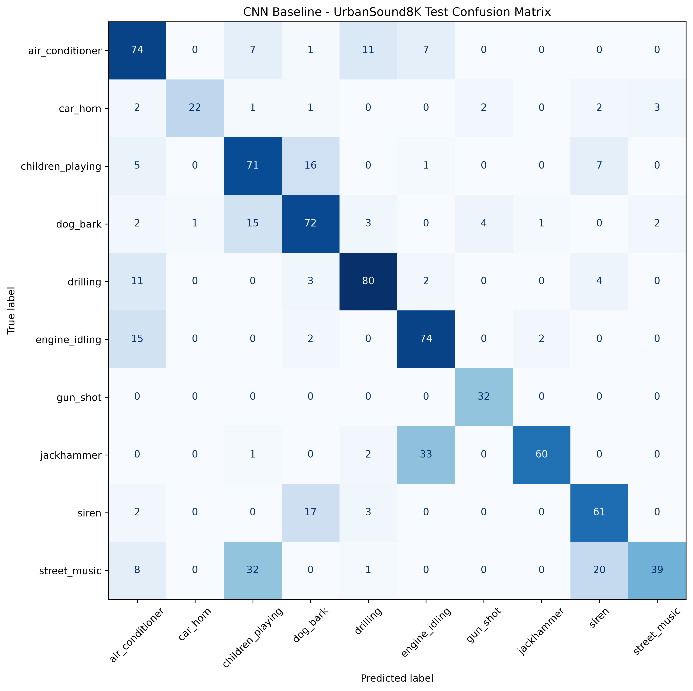
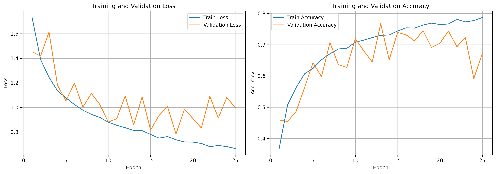
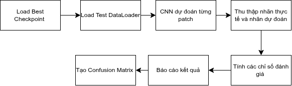

## 1. Chuẩn hóa quá trình huấn luyện:

- Trong quá trình huấn luyện, sẽ có nhiều tham số điều khiển quá trình huấn luyện như:

| Tham số       | Giá trị ban đầu | Ý nghĩa                               |
| ------------- | --------------- | ------------------------------------- |
| BATCH_SIZE    | 32              | Số mẫu trong một batch                |
| LEARNING_RATE | 0.001           | Tốc độ cập nhật trọng số              |
| NUM_EPOCHS    | 30              | Số vòng huấn luyện tối đa             |
| PATIENCE      | 7               | Số epoch chờ trước khi Early Stopping |

- Những tham số này hiện tại đang nằm rải rác trong nhiều file, vì vậy việc tái lập thực nghiệm cũng như là kiểm thử những cấu hình khác nhau sẽ trở nên khó khăn
- Vì vậy, ta sẽ gom những tham số này vào một file config.py giúp:
  - Có một nơi để quản lý tất cả tham số
  - Các file Python khác trong dự án có thể dùng chung cấu hình
  - Dễ dàng thay đổi tham số để thực nghiệm
  - Dễ dàng ghi lại tham số cấu hình tương ứng với kết quả huấn luyện

### 1.1 Traning configuration

- Đây là những tham số điều khiển quá trình huấn luyện.

| Tham số       | Giá trị ban đầu | Ý nghĩa                               |
| ------------- | --------------- | ------------------------------------- |
| BATCH_SIZE    | 32              | Số mẫu trong một batch                |
| LEARNING_RATE | 0.001           | Tốc độ cập nhật trọng số              |
| NUM_EPOCHS    | 30              | Số vòng huấn luyện tối đa             |
| PATIENCE      | 7               | Số epoch chờ trước khi Early Stopping |

### 1.2 Dataset Configuration

- Các thông số này liên quan đến dữ liệu đầu vào và tiền xử lý.

| Tham số     | Giá trị ban đầu | Ý nghĩa                         |
| ----------- | --------------- | ------------------------------- |
| NUM_CLASSES | 10              | Số lớp âm thanh                 |
| SAMPLE_RATE | 16000           | Tần số lấy mẫu                  |
| DURATION    | 4.0             | Thời lượng file âm thanh (giây) |
| N_MELS      | 64              | Số Mel frequency bins           |

### 1.3 Model Configuration

- Thông số này liên quan đến kiến trúc CNN.

| Tham số | Giá trị ban đầu | Ý nghĩa                                           |
| ------- | --------------- | ------------------------------------------------- |
| DROPOUT | 0.3             | Tỷ lệ neuron bị bỏ qua trong quá trình huấn luyện |

### 1.4 Reproducibility Configuration

| Tham số | Giá trị ban đầu | Ý nghĩa                     |
| ------- | --------------- | --------------------------- |
| SEED    | 42              | Giá trị khởi tạo ngẫu nhiên |

- Đây là tham số Random Seed
- Trong Deep Learning, có nhiều hoạt động sử dụng số ngẫu nhiên:
  - Khởi tạo trọng số ban đầu của CNN
  - Xáo trộn dữ liệu trước mỗi epoch
  - Dropout lựa chọn neuron để loại bỏ
  - Các phép biến đổi ngẫu nhiên nếu có
- Do đó, dẫn đến việc cùng một kiến trúc và cùng một dữ liệu huấn luyện nhưng kết quả huấn luyện có thể khác nhau
- Random Seed giúp kiểm soát những yếu tố ngẫu nhiên này

## 2. Đánh giá quá trình huấn luyện:

- Sau khi đã quản lý được các tham số ảnh hưởng đến quá trình huấn luyện, tiếp theo sẽ là quy trình đánh giá mô hình trên tập test
- Sau khi đã huấn luyện, mô hình tốt nhất được lưu checkpoints ở outputs/checkpoints/best_cnn.pth
- Mô hình tốt nhất được lựa chọn sau mỗi vòng lặp huấn luyện khi mô hình đó có trung bình Validation Loss nhỏ nhất
- Checkpoint này sẽ lưu toàn bộ tham số đã học của CNN, validation loss và validation accuracy của mô hình sau vòng lặp huấn luyện, cũng như là các tham số ảnh hưởng đến quá trình huấn luyện
- Để đánh giá mô hình đã được huấn luyện, ta sử dụng các chỉ số:

### 2.1 Accuracy - Độ chính xác tổng thể

- Accuracy sẽ cho biết tỷ lệ số mẫu được mô hình phân loại đúng trên tổng số mẫu:

```math
\text{Accuracy} = \frac{\text{Số dự đoán đúng}}{\text{Tổng số mẫu}}
```

- Ở kết quả huấn luyện hiện tại của dự án, Accuracy = 0.6989 = 69.89%. Như vậy có nghĩa là mô hình có thể phân loại đúng khoảng 70 trong mỗi 100 mẫu âm thanh kiểm tra
- Hạn chế: Accuracy có thể không đáng tin cậy khi các lớp có số lượng mẫu không cân bằng. Ở đây, UrbanSound8K có số mẫu giữa các lớp khác nhau, vì vậy cần phải có thêm các chỉ số đánh giá khác

### 2.2. Precision - Độ chính xác của dự đoán theo lớp:

- Precision sẽ cho biết trong tất cả những mẫu mô hình dự đoán thuộc 1 lớp, có bao nhiêu mẫu thực sự thuộc lớp đó.

```math
\text{Precision} = \frac{Số mẫu dự đoán đúng}{Số mẫu dự đoán đúng + Số mẫu dự đoán sai}
```

- Precision cao nghĩa là mô hình ít gán nhầm âm thanh của các lớp khác thành lớp đang xét

### 2.3. Recall - Khả năng nhận diện đầy đủ

- Recall cho biết trong tất cả những mẫu thuộc 1 lớp, mô hình dự đoán đúng được bao nhiêu mẫu

```math
\text{Recall} = \frac{TP}{TP + FN}
```

- Recall cao có nghĩa là mô hình ít bỏ sót những mẫu thực sự thuộc lớp đó

### 2.4. F1-score - Sự cân bằng giữa Precision và Recall

- F1-score là trung bình điều hòa giữa Precision và Recall

```math
\text{F1} = 2 \times \frac{\text{Precision} \times \text{Recall}}{\text{Precision} + \text{Recall}}
```

- F1-score giúp chúng ta đánh giá đồng thời khả năng hạn chế dự đoán nhầm và hạn chế bỏ sót

### 2.5. Macro-F1 và Weighted-F1:

- Macro-F1 là trung bình cộng F1-score của từng lớp:

```math
\text{Macro-F1} = \frac{1}{C} \sum_{i=1}^{C} \text{F1}_i
```

- Macro-F1 giúp đánh giá công bằng trên toàn bộ lớp, tránh việc những lớp nhiều mẫu chi phối kết quả

- Weighted-F1 là trung bình F1-score có trọng số theo số mẫu của từng lớp

```math
\text{Weighted-F1} = \frac{\sum_{i=1}^{C} n_i \, \text{F1}_i}{\sum_{i=1}^{C} n_i}
```

- Weighted-F1 phản ánh hiệu suất trung bình có xét đến phân bố mẫu thực tế

### 2.6. Confusion matrix - Ma trận nhầm lẫn:

- Đây chính là công cụ giúp ta hiểu rõ mô hình đang phân loại sai như thế nào<br>

  

  <br>

- Hàng: Nhãn thực tế (True Labels)
- Cột: Nhãn dự đoán (Predicted Labels)
- Đường chéo chính: Số lượng dự đoán chính xác
- Các ô ngoài đường chéo chính: Số lượng dự đoán nhầm
- Confusion Matrix giúp chúng ta tìm ra những cặp âm thanh dễ nhầm lẫn, từ đó đưa ra hướng cải thiện tiền xử lý hoặc kiến trúc mô hình.

## 2.7. Learning curves - Đường cong học tập

- Đây là biểu đồ thể hiện thay đổi của các chỉ số huấn luyện và validation qua từng vòng lặp huấn luyện<br>

  
  <br>

- Ta có 2 biểu đồ:
  - Biểu đồ 1: Training Loss và Validation Loss
  - Biểu đồ 2: Training Accuracy và Validation Accuracy

## 2.7.1 Mô hình underfitting - mô hình chưa học đủ

- Đặc điểm của learning curve:
  - Training Loss còn cao.
  - Validation Loss cũng cao.
  - Training Accuracy thấp.
  - Validation Accuracy thấp.
  - Hai đường Accuracy thường chưa đạt mức tốt.
- Nguyên nhân có thể:
  - Kiến trúc mô hình chưa đủ khả năng biểu diễn.
  - Huấn luyện chưa đủ lâu.
  - Learning Rate chưa phù hợp.
  - Đặc trưng đầu vào chưa đủ tốt.

## 2.7.2 Mô hình good fit - mô hình học và tổng quát hóa tốt

- Đặc điểm của learning curve:
  - Training Loss giảm.
  - Validation Loss giảm và dần ổn định.
  - Training Accuracy tăng.
  - Validation Accuracy tăng và tương đối ổn định.
  - Khoảng cách giữa hai đường không quá lớn.
- Đây là trạng thái mà chúng ta mong muốn

## 2.7.3 Mô hình overfitting - mô hình học thuộc dữ liệu huấn luyện

- Đặc điểm của learning curve:
  - Training Loss tiếp tục giảm.
  - Validation Loss bắt đầu tăng.
  - Training Accuracy tiếp tục tăng.
  - Validation Accuracy dừng tăng hoặc giảm.
  - Khoảng cách giữa hai đường ngày càng lớn.
- Nguyên nhân có thể:
  - Mô hình quá phức tạp so với dữ liệu.
  - Thiếu dữ liệu huấn luyện.
  - Thiếu các kỹ thuật Regularization.
  - Huấn luyện quá lâu.
- Trong trường hợp này, chúng ta có thể xem xét Dropout, Data Augmentation, giảm độ phức tạp mô hình hoặc Early Stopping.

## 2.8. Quy trình đánh giá thực tế trong mã nguồn



## 2.9 Kết quả đánh giá
